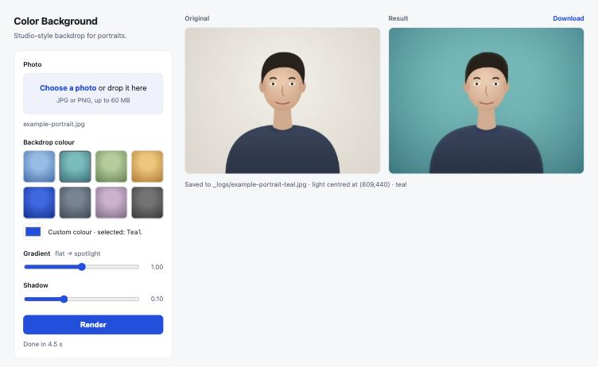

# headshot-studio

Replace the background of a portrait with a studio-style coloured backdrop: a soft light behind the head that falls off toward the corners, a subtle shadow, and edges blended into the new colour so the subject doesn't look pasted on.

The output is deterministic: the same photo and settings always give the same image.



## Setup

Requires [uv](https://docs.astral.sh/uv/) and `make`.

```bash
make install
```

The first render downloads the segmentation model (~170 MB) into `.cache/`. All caches stay inside the project: `.cache/` for the model and compiled code, `.venv/` for the environment.

## Web interface

```bash
make ui
```

This opens `http://127.0.0.1:8765/` (use `make ui PORT=9000` for another port). Choose a photo or drop it on the page, pick a colour, adjust the sliders and press **Render**. Each result is shown next to the original and saved to `_logs/<photo>-<colour>.jpg`.

The server only listens on your own machine.

## Command line

```bash
make background IN=photo.jpg COLOR=sky-blue
make background IN=photo.jpg COLOR='#0D4FE4' ARGS='--gradient 1.5 --shadow 0.15'
```

The result goes to `_logs/photo-bg.jpg` unless you pass `OUT=...`.

| Option | Default | Effect |
|---|---|---|
| `COLOR` | lilac | A preset name or any hex colour |
| `--gradient` | `1.0` | Backdrop falloff: `0` flat colour, `1` default, `2` dark corners / spotlight |
| `--shadow` | `0.10` | Strength of the soft shadow behind the subject (`0`–`0.3`) |
| `--light`, `--dark` | from `COLOR` | Set the centre and corner colours exactly |
| `--center X Y` | auto | Where the light sits, in pixels; detected from the head by default |
| `--white-balance` | `0.7` | How much of the original light's colour cast to remove |

Presets: `sky-blue`, `teal`, `sage`, `amber`, `artificialy-blue`, `slate-blue`, `lilac`, `charcoal`.

## How it works

1. **Cutout:** [rembg](https://github.com/danielgatis/rembg) with the `isnet-general-use` model, plus alpha matting for hair edges.
2. **Colour correction:** if the original wall is near-neutral, its tint is treated as the light's colour cast and mostly removed from the subject. Coloured walls are left alone.
3. **Backdrop:** a radial gradient between a light and a dark tone, centred behind the head, with faint texture.
4. **Shadow and light wrap:** a soft offset shadow on the backdrop, and the backdrop colour blended into the subject's outline.
5. **Finish:** slight contrast and seeded film grain.

## Getting good results

- A plain, light, evenly lit wall (white, off-white, light grey or beige), with you standing 50 cm to 1 m in front of it so there are no hard shadows next to your head.
- Soft light on the face, with no bright window or lamp behind you.
- Clothes and hair that contrast with the wall. A white shirt on a white wall is the hardest case.
- One person, with some space above the head. Arms close to the body avoid wall showing through gaps.
- A sharp photo, ideally at least 1500 px on the short side. JPG or PNG; convert iPhone HEIC files first.

## Project layout

```
src/color_background/   renderer (studio.py) and command line (cli.py)
src/frontend/           local web interface (server.py, index.html)
Makefile                install, background, ui, clean, clean-cache
_logs/                  rendered photos (git-ignored)
.cache/                 model and caches (git-ignored)
```
